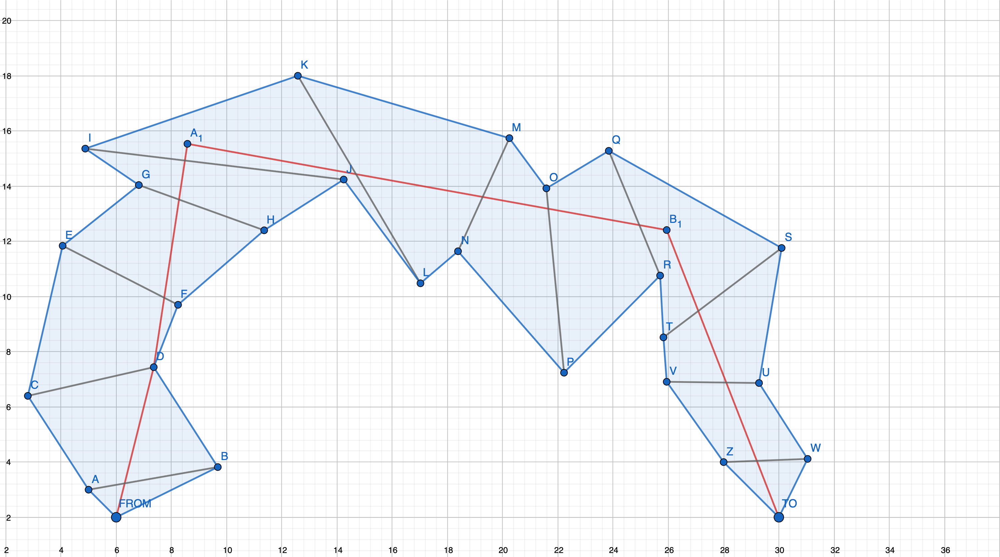
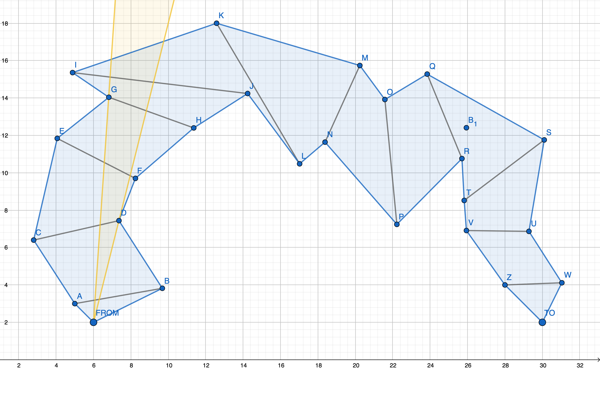
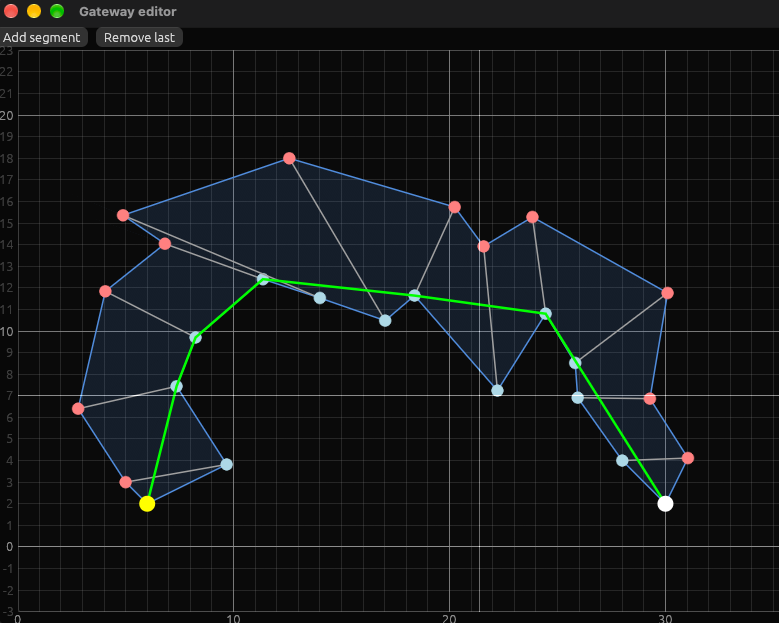

# Orca coding challenge

https://github.com/orca-io/orca-challenges/tree/master/challenge-shortest-path

## The problem

Given a an origin, a destination, and an ordered list of gateway segments,

find the shortest path from origin to destinations that passes all gateway segments in order.

The segments are oriented, i.e. in a solution we know which point should lie on the left and which on the right. However, according to the hints the segments are well behaved,
so we can assume that the next segment is sight in the correct orientation after passing the previous segment.

## The solution

The problem is equivalent to finding a shortest path in a simple polygon.
Usually finding this shortest path consists of two steps,



- finding a shortest path in a nice triangulation of the polygon (think of it as finding a path in a maze/labyrinth),
- then finding the shortest path in the polygon along the path in the maze (think of a rubber band spanned between origin and destination: on which vertices of the polygon is the band suspended when it's contracted).

The first part of the solutions can be skipped here, the order of the gateway segments already gives us the "path in the maze" and we can focus on the second part of the solution.

There are two solutions to the solver in the solver.hpp file. `my_solution` implements a simple algorithm that unfortunately has a complexity of O(n^2) in the worst case.
The idea is simple: we narrow the visibility wegdge from the last known vertex of the optimal path (yellow). The first segment that is not visible any more (K->L in the image below) lies to the right of the visibility wedge, so we take the point D, which limits the visibility wedge to the right as next point of the optimal path.



When checking how to get rid of the O(n^2) complexity in `funnels` I looked up the shortest path algorithms in polygons and found the "funnel algorithm" which is a linear time algorithm to find the shortest path in a simple polygon. This algorithm is implemented in the section `Book solution` in the solver.
The [algorithm is documented here](https://www.cs.princeton.edu/techreports/1986/039.pdf).

# Running

With C++ and rust toolchain installed

```bash
make run
```

runs a server and a rust gui.



# AI disclaimer

The infrastructure and demo tool code was build with AI assistance, but my solution to the problem was implemented by me.
